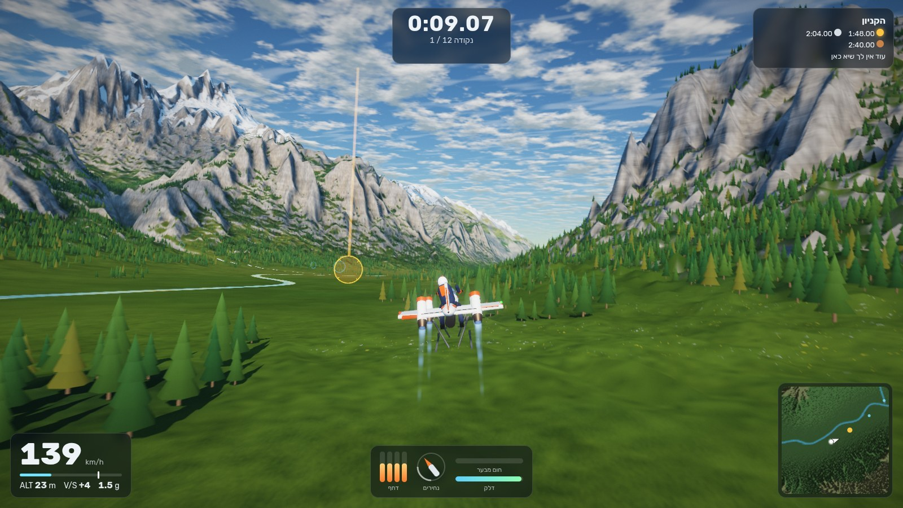
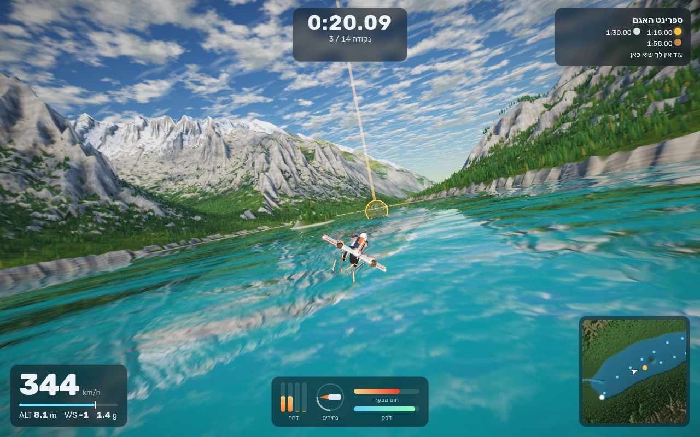

# FÖHN: אופנוע סילון בעמק אלפיני

הפרויקט השלישי במשפחת האופנועים המעופפים, אחרי `opus5` ו-`jetbike_game` (MJ-5). המטרה הייתה לעקוף את שניהם בפיזיקה, בגרפיקה ובמשחקיות.

השם: Föhn (נהגה "פֶן") היא הרוח החמה והיבשה שיורדת מהאלפים אל העמקים. המילה הגרמנית הגיעה מהלטינית *favonius*, רוח המערב הנעימה.

**משחק חי:** https://orimosenzon.github.io/fun/vibe_coding/jetbikes/foehn/ . אפשר להתקין אותו כאפליקציה (manifest + service worker), ואחרי טעינה ראשונה הוא עובד גם בלי רשת.

**להרצה:** `python3 -m http.server 8790` בתיקייה, ואז `http://localhost:8790/`. אין שלב בנייה ואין תלות ברשת: Three.js נמצא ב-`lib/`.

## מה חדש לעומת שני הקודמים

### פיזיקה
הכלי הוא F-5: אופנוע בלי גלגלים ובלי כנפיים. ההנחה היחידה שחורגת מהיום היא המנוע: ליבת היתוך קומפקטית שמחממת את האוויר שהמדחס בולע. אין דלק שנשרף, ויש דחף של כ-14,000 ניוטון, יותר מפי ארבעה ממשקל האופנוע והרוכב (304 ק"ג). כל השאר מכניקה רגילה.

האוויר החם עובר דרך מפצל לחמש יציאות:

- **נחיר אחורי**, במקום שבו נמצא האגזוז של אופנוע, עם דחף־יתר והסטת דחף בשני צירים. הוא נותן את הדחף קדימה.
- **ארבעה נחירי הרמה** במקום הגלגלים, שניים בציר הקדמי ושניים באחורי. לכל אחד שסתום מהיר שקובע את חלקו באוויר, ומדף הסטה. ארבעתם יכולים לנטות יחד 26° קדימה, וזה הבלם.

אין עילוי מהאוויר. המשקל, הפניות והטיפוס הם כולם דחף, בכל מהירות. לכן האופנוע פונה ב-3.4 g גם ב-70 קמ"ש וגם ב-300, ופניית פרסה מ-200 קמ"ש לוקחת פחות מ-4 שניות ברוחב של 100 מטר. המנוע עדיין נושם אוויר, ולכן הדחף יורד עם הגובה. פיצול האוויר עולה בדחף: חצי אחורה וחצי למטה נותנים 71% מהכוח של הכול לכיוון אחד.

(גרסאות קודמות: F-3, tilt-jet עם ארבעה מנועים קטנים. F-4, מנוע סילון אחד גדול עם כנף.)

- גוף קשיח ב-6 דרגות חופש, 600 הרץ, עדכון סיבוב מדויק (מפה אקספוננציאלית), טנזור התמד מלא שמחושב ממסות הרכיבים.
- אווירודינמיקה: גרר של גוף קהה (אופנוע ורוכב) לכל ציר, עם מרכזי לחץ נפרדים, ריסון סיבובי ומעצור אוויר. בלי כנף, בלי מייצבים ובלי הגאים.
- המנוע: השהיית סחרור, דחף שיורד עם הגובה, גרר ספיגה בכניסת האוויר, הפסדי צנרת, דחף־יתר עם תקציב חום, אפקט קרקע. לרוטור יש תנע זוויתי אמיתי, והמחשב מקזז אותו.
- כוח הגלגול מגיע רק מנחירי ההרמה, שעומדים 20 ס"מ מקו האמצע. לכן המחשב לא נותן להם להתרוקן, ופותח אותם יותר כשמומנט הגלגול הדרוש גדל (למשל רוח צד על גב הרוכב במהירות).
- הלהבה של כל נחיר, הזוהר שלו, הזוהר של הליבה והאבק שעולה מהקרקע נגזרים מהדחף שיוצא באותו רגע בסימולציה.
- רוח הרים: רוח עמק עם שכבת גבול, עילוי ושקיעה אורוגרפיים על מדרונות, ומשבים שמתחזקים ליד קרקע תלולה.

### מחשב הטיסה
חוק בקרה "מאוחד", ברוח מטוסי STOVL מודרניים: הרוכב מבקש וקטור מהירות (קצב פנייה, קצב טיפוס, מהירות קדימה, הזזה הצידה), והמחשב:
1. גוזר את התאוצה הדרושה ואת העמדה: הטיה לפנייה, והאף עוקב אחרי מסלול הטיסה, כמו אופנוע בעלייה ובירידה.
2. קובע כמה אוויר המנוע צריך להזיז ואיך המפצל מחלק אותו. הגובה קודם: הנחיר האחורי מקבל את מה שנחירי ההרמה לא צריכים.
3. פותר בכל רגע בעיית הקצאת בקרה: 10 מפעילים (החלקים של 4 נחירי ההרמה, 4 המדפים שלהם, שני צירי ההסטה של הנחיר האחורי) בריבועים פחותים משוקללים עם אילוצים.

**פניות.** גבול ההטיה נגזר מהדחף הזמין (עד 73°, 3.4 g). פנייה מלאה שמוחזקת יותר מחצי שנייה היא "פניית סיכה": המחשב מוריד את המהירות ל-85 קמ"ש, שם האופנוע מסתובב הכי צר, ומחזיר אותה בשחרור. הטייס האוטומטי נשאר מתחת לפנייה מלאה ומתכנן מהירות בעצמו.

הגנות: מכ"ם קרקע שרואה גם צמרות וגגות, נחיתה עם ריכוך אוטומטי, ומהירות מרבית לדחף־היתר (450 קמ"ש), כי בלי זה רק הגרר עוצר את האופנוע. כל כוח עדיין עובר דרך המנוע והנחירים המדומים.

### גרפיקה
- עמק אפוי מראש (`tools/bake.mjs`): רשת עמקים מתוכננת, הרים מחורצים, סחיפה הידראולית של 700 אלף טיפות, אגם, אגם הררי, נהרות וקניון צר. הפיזיקה והציור קוראים את אותו קובץ גבהים.
- אטמוספירה: פיזור רייליי ומי מחושב לטבלת שמיים. כל השיידרים לוקחים ממנה את צבע השמיים, האובך והאור הסביבתי, ולכן ההרים הרחוקים נמוגים בדיוק אל השמיים שמאחוריהם. חמש שעות ביום.
- קרקע: סלע עם שכבות, דרדרת, אחו, קרקע יער, שלג, חופים. צללי ההרים נאפים לטקסטורה, ליד המצלמה יש מפת צללים חיה, ועוד צללי עננים.
- אגם עם השתקפות מישורית, צבע קרחוני לפי עומק, קצף חוף וגלים מהסילון.
- כ-150 אלף עצים באינסטנסים, כפר, כנסייה, בקתות הרים.
- עיבוד: HDR עם MSAA, בלום, קרני שמש, טשטוש תנועה ממפת העומק, ACES.

### משחקיות
שישה אירועים במקום מסלול אחד, עם מדליות (ארד, כסף, זהב), שיא אישי, זמני ביניים ורוח רפאים של הריצה הטובה:

| אירוע | מה עושים |
|---|---|
| טיסת בכורה | המראה, שש טבעות רחבות, נחיתה בכיכר הכפר |
| ספרינט האגם | נמוך מעל המים, סביב האי |
| הקניון | 900 מטר טיפוס בתוך קניון צר |
| מעבר ההר | אוויר דליל מעל הרכס וצלילה לעמק |
| שליח ההרים | שלוש נחיתות מדויקות, מסלול חופשי |
| הסיבוב הגדול | 22 ק"מ: מעבר ההר, הקניון בירידה, האגם |

ועוד טיסה חופשית עם ניקוד על טיסה מהירה וקרובה לקרקע. פספוס טבעת עולה 4 שניות ולא עוצר את הריצה. אחרי התרסקות חוזרים לנקודה האחרונה. ארבע מצלמות, שלט משחק, מגע בסיסי, וטייס אוטומטי שמדגים ברקע התפריט.

## מקשים

| מקש | פעולה |
|---|---|
| `←` `→` | פנייה (האופנוע נוטה לבד). לחיצה ארוכה: פניית סיכה |
| `↓` `↑` | למשוך לטפס, לדחוף לרדת |
| `W` `S` | מהירות יעד |
| `Space` | דחף־יתר |
| `Shift` | בלם עד ריחוף |
| `A` `D` | הזזה הצידה בריחוף |
| `C` · `R` · `Esc` · `M` · `H` | מצלמה · מחדש · הפסקה · השתקה · עזרה |

## קוד

| קובץ | תוכן |
|---|---|
| `js/sim/bike.js` | הכלי: מסות, מנועים, אווירודינמיקה, אינטגרציה |
| `js/sim/fcs.js` | מחשב הטיסה והקצאת הבקרה |
| `js/sim/terrain.js`, `wind.js`, `scenery.js` | שטח, רוח, עצים ומבנים (משותפים לפיזיקה ולציור) |
| `js/sim/courses.js`, `game.js`, `autopilot.js` | אירועים, חוקי המשחק, טייס אוטומטי |
| `js/render/*` | שמיים, קרקע, מים, יער, מבנים, האופנוע, אפקטים, עיבוד |
| `js/ui/*`, `js/main.js` | קלט, שמע, HUD, תפריטים, לולאת המשחק |
| `tools/bake.mjs` | אפיית העולם אל `assets/` |

כל `js/sim/` נקי מ-DOM ורץ גם ב-Node.

## בדיקות וכלים

- `node tests/physics.mjs`: ריחוף, שיוט על דחף בלבד, פנייה, פניית פרסה, בלימה, נחיתה, רוח, דטרמיניזם, דחף מול גובה.
- `node tests/_turn.mjs hold 1100`, `node tests/_back.mjs`: מדידת פניות פרסה וחזרה לנקודה.
- `node tests/monkey.mjs 40 150`: קלטים אקראיים ורוח. מחשב הטיסה לא אמור לאבד את הכלי אף פעם.
- `node tests/events.mjs`: הטייס האוטומטי טס את כל האירועים בלי תצוגה.
- `python3 tools/shot.py OUT "event=lake&demo" 10 20`: ריצה על ה-GPU עם צילומי מסך.
- `python3 tools/play.py OUT first "KeyW:3:1,ArrowDown:2:0" 30`: מקלדת אמיתית עם טלמטריה.

דגלי URL: `?event=gorge`, `&demo`, `?time=golden`, `?q=low`, `?cam=cockpit`, `?touch`.

## פתוח

- איש עוד לא טס ביד. תחושת ההיגוי כוילה רק בבדיקות אוטומטיות.
- זמני המדליות נגזרו מהטייס האוטומטי. הוא מסיים את כל ששת האירועים, אבל עדיין מפספס טבעת או מתרסק פה ושם, בעיקר אחרי דחף־יתר.
- השמע והמגע לא נבדקו על מכשיר אמיתי.
- רעיונות: דשא תלת-ממדי ליד המצלמה, אדי חום מאחורי הסילונים, מצב ידני בלי מחשב טיסה.
