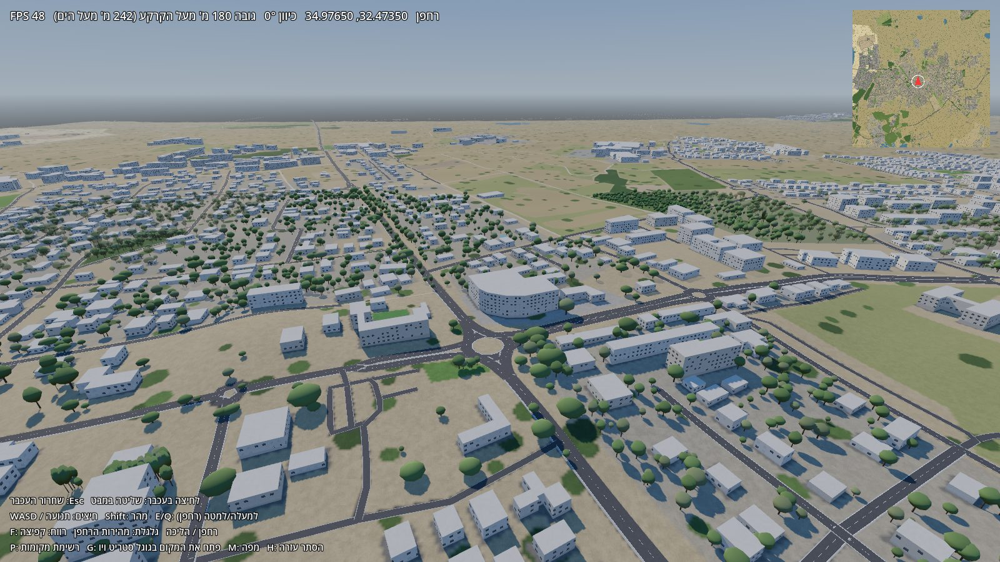
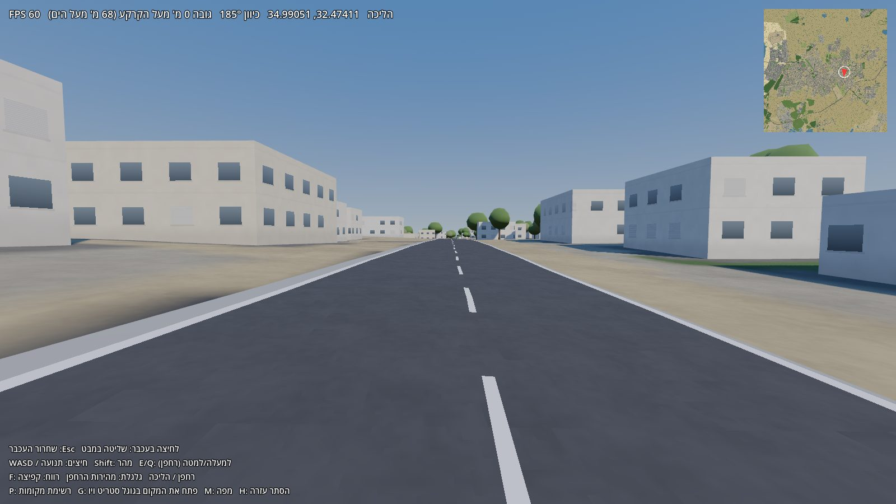
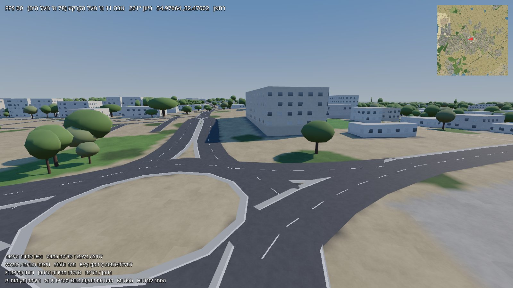

# פרדס חנה תלת-ממד

<div dir="rtl">

המושבה פרדס חנה-כרכור כעולם תלת-ממדי שאפשר לטוס מעליו וללכת ברחובותיו.
המטרה לטווח הארוך: מודל שנראה כמו המושבה האמיתית, בית אחרי בית, לפי תמונות רחוב.



## מה יש עכשיו (גרסה 0.1, 13/10/2026)

- **כל שטח המועצה** (כ-7.5×7.3 ק"מ): 8,646 בניינים, 2,542 קטעי כביש, שבילים ומסילת הרכבת, מתוך OpenStreetMap.
- **טופוגרפיה אמיתית** ממודל הגבהים (DEM, כלומר
  Digital Elevation Model,
  "מודל גבהים ספרתי"): מ-6 מ' במערב עד 112 מ' על הגבעות של כרכור.
- **עצים**: 1,924 עצים אמיתיים מסקר העצים של 2018–2019 (מפרדספדיה, דרך הנתונים של דרך קיצור), כל אחד בגובה ובקוטר הצמרת שנמדדו. בנוסף כ-148 אלף עצים "ממולאים" בפרדסים, בחורשות, בפארקים ובשכונות, כי הסקר מכסה רק חלק קטן. הם מסומנים בנתונים כסינתטיים.
- **בניינים** עם חלונות, תריסי גלילה ואדנים שמצוירים בשיידר (shader,
  "מצליל", מ-to shade: התוכנית הקטנה שרצה בכרטיס המסך וקובעת את צבע כל פיקסל), בלי טקסטורות.
- **כבישים** עם סימון, אבני שפה, אבנים משתלבות במדרכות, דרכי עפר ומסילה.
- **שני מצבי תנועה**: רחפן (טיסה חופשית) והליכה בגובה העיניים עם התנגשות בבניינים.
- **מפה קטנה**, **רשימה של 232 מקומות** לקפיצה, ו**מקש G שפותח את גוגל סטריט ויו בדפדפן** בדיוק במיקום ובכיוון שבו אתה עומד, כדי להשוות בעין.
- 50–60 פריימים לשנייה על ה-GTX 1060.




## הרצה

</div>

```bash
cd pardes3d
make setup     # סביבת פייתון (פעם אחת)
make data      # OSM + גבהים (פעם אחת, כדקה)
make world     # בניית העולם (כ-30 שניות)
make run       # המשחק
```

<div dir="rtl">

Godot מותקן ב-`~/.local/opt/godot` עם קיצור `~/.local/bin/godot`.

**מקשים:** לחיצה בעכבר לשליטה במבט, Esc לשחרור. WASD או חיצים לתנועה, Shift למהירות. E/Q למעלה/למטה ברחפן, גלגלת למהירות הרחפן.
F מחליף בין רחפן להליכה. P רשימת מקומות (לחיצה כפולה לקפיצה). G פותח סטריט ויו. M מפה. H מסתיר את העזרה.

צילום מסך אוטומטי (לבדיקות, בלי לגעת בעכבר):

</div>

```bash
make shot ARGS="--at=32.4741,34.9905 --alt=0 --heading=185"
```

<div dir="rtl">

## החלטות

### למה Godot ולא Unreal

שקלנו את Unreal Engine 5, ובחרנו ב-Godot 4.7:

1. **חופשי באמת.** Godot ברישיון MIT. Unreal הוא קוד "זמין לקריאה" עם תמלוגים, ולהורדה צריך חשבון Epic וכניסה ידנית, כך שלא יכולתי להתקין אותו לבד.
2. **המחשב.** Unreal 5 צריך 100GB+ דיסק, ולמחשב הזה יש 16GB זיכרון (כ-6 פנויים בדרך כלל) וכרטיס GTX 1060 בן 10 שנים. Nanite ו-Lumen, הסיבות העיקריות לבחור ב-Unreal, לא באמת ירוצו עליו. Godot שוקל 120MB ונפתח בשנייה.
3. **ווב.** ל-Godot יש ייצוא לדפדפן, כך שאפשר יהיה לשים את המושבה ב-GitHub Pages.
4. **לא נעולים.** כל צינור הנתונים כתוב בפייתון ומוציא glTF, פורמט פתוח שכל מנוע קורא. אם נרצה לעבור ל-Unreal (או ל-Cesium for Unreal) כשיהיה מחשב חזק, הנתונים יעברו כמו שהם.

### למה לא מורידים תמונות מגוגל סטריט ויו

תנאי השימוש של Google Maps Platform אוסרים במפורש ליצור תוכן מתמונות של גוגל: לא מודלים תלת-ממדיים, לא טקסטורות ולא חילוץ מאפיינים. הם גם אוסרים לשמור את התמונות, וה-API בתשלום. לכן בפרויקט הזה סטריט ויו משמש **רק כרפרנס לעין**, דרך מקש G שפותח את גוגל מפות בדפדפן.

את התמונות שמהן נבנה המודל ניקח ממקורות פתוחים:

- **Mapillary**: תמונות רחוב שמשתמשים מעלים, ברישיון CC BY-SA, עם מיקום וכיוון מצלמה מדויקים. הסקריפט `pipeline/fetch_mapillary.py` מוכן, וצריך רק מפתח חינמי (הוראות בראש הקובץ). עוד לא בדקנו כמה כיסוי יש במושבה.
- **צילומים שלנו**: הליכה ברחובות עם טלפון, ועדיף עם מצלמת 360. אפליקציית דרך קיצור כבר מקליטה מסלולי הליכה, ואפשר לחבר אליה צילום. כל תמונה כזאת שלנו לגמרי.
- **צילומי אוויר פתוחים** (אורתופוטו של המרכז למיפוי ישראל, אם יתאפשר ברישיון) לגגות ולגינות.

## איך זה בנוי

</div>

```
pardes3d/
  pipeline/            פייתון: מהנתונים הגולמיים לעולם
    geo.py             מערכת הקואורדינטות (מישור משיק סביב מרכז המושבה, במטרים)
    fetch_osm.py       Overpass → data/raw/osm.json
    fetch_dem.py       אריחי Terrarium (AWS) → data/raw/dem.npz
    fetch_mapillary.py תמונות רחוב פתוחות (דורש מפתח)
    build_world.py     → game/world/: terrain.glb, buildings.glb, roads.glb,
                         ground.png, heights.bin, trees.json, places.json, meta.json
  game/                פרויקט Godot 4.7
    scripts/main.gd    סביבה, שמש, ערפל; פרמטרים לצילום אוטומטי
    scripts/world.gd   טעינת ה-glb בזמן ריצה, עצים ב-MultiMesh, גובה קרקע
    scripts/player.gd  רחפן והליכה
    scripts/hud.gd     מידע, מפה, מקומות, סטריט ויו
    shaders/           בניינים, כבישים, קרקע
  docs/                צילומי מסך
  memory/              זיכרון הפרויקט לסשנים הבאים
```

<div dir="rtl">

**קואורדינטות:** בגודו x = מזרח, y = למעלה, z = דרום (צפון הוא z שלילי). מרכז העולם בנקודה 32.4735, 34.9765.

**הנכסים של העולם לא בגיט** (כ-55MB). הם נבנים מחדש ב-`make data && make world`. התיקייה `game/world` מסומנת ב-`.gdignore` והכל נטען בזמן ריצה עם GLTFDocument, כדי שהעורך של Godot לא ינסה לייבא אותה.

## תוכנית העבודה

**שלב 1: גאומטריה נכונה יותר**
- גובה בניינים: ב-OSM רק ל-63 מתוך 8,646 בניינים יש מספר קומות, והשאר מנוחש (רוב המושבה קומה או שתיים). צריך מקור: שכבת מבנים של המרכז למיפוי ישראל, מודל פני שטח (DSM) פחות מודל קרקע, או ספירת קומות מתמונות רחוב (שלב 3).
- בניינים חסרים: להשוות ל-Microsoft Global Building Footprints ולהשלים.
- גגות רעפים משופעים לבתים צמודי קרקע, דודי שמש ופאנלים על גגות שטוחים.
- גדרות וחומות בין המגרשים (חלק גדול ממראה הרחוב בפרדס חנה), מדרכות נפרדות מהכביש, עמודי תאורה.
- מגוון עצים לפי המין בסקר (פיקוס, אקליפטוס, דקל, ברוש, הדר).

**שלב 2: תמונות רחוב**
- להפעיל את Mapillary, לבדוק כיסוי, להציג נקודות צילום במפה ובעולם.
- כלי צילום עצמי: מסלול הליכה + תמונות עם מיקום וכיוון.

**שלב 3: מהתמונה למודל**
- לכל בניין: למצוא את התמונות שרואות אותו (לפי מיקום וכיוון המצלמה).
- מודל ראייה (Claude Vision) קורא כל חזית ומחזיר תכונות: מספר קומות, צבע טיח, סוג גג, גדר, חלונות, מרפסות. העולם נבנה מחדש מהתכונות. זה דרך זולה וחוקית ל"להעתיק" את המושבה, וקל לתקן ידנית.
- הקרנת התמונות עצמן על הקירות כטקסטורה, לבניינים שיש להם תמונה טובה.
- **עלות:** כ-9,000 בניינים × כמה תמונות לבניין. ב-Haiku או ב-Sonnet זה בערך עשרות דולרים לכל המושבה. נריץ קודם על רחוב אחד, עם תקרת הוצאה במפתח.

**שלב 4: מקומות מיוחדים בפוטוגרמטריה**
- לנקודות ציון (מגדל המים, תחנת הרכבת, המועצה, בית העם): שחזור מלא מעשרות תמונות עם COLMAP, או 3D Gaussian Splatting, שיש לו תוספים ל-Godot. על ה-1060 עם 6GB זה איטי אבל אפשרי לסצנה קטנה.

**שלב 5: לשתף**
- ייצוא לווב (Godot Web) והעלאה ל-GitHub Pages, עם חלוקת העולם לאריחים שנטענים לפי הצורך.
- חיבור לפרדספדיה: לחיצה על בניין או מקום פותחת את הערך שלו.

## מקורות ורישיונות

- © תורמי OpenStreetMap, ברישיון ODbL
- גבהים: Mapzen Terrarium / SRTM, דרך AWS Open Data
- סקר העצים 2018–2019 של המועצה, מפרדספדיה
- Godot Engine, ברישיון MIT

</div>
